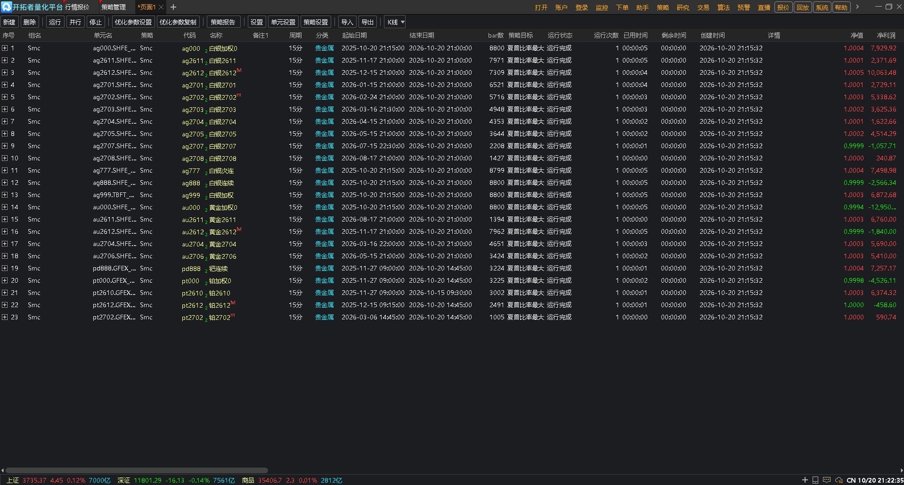

## 项目介绍

做SMC策略，难的不是写一个BOS、OB、FVG函数，而是把摆动高低点、结构突破、订单块、缺口、流动性、前周期高低点、加权评分、开平仓与止损止盈串成一套能跑的闭环。

这份源码按TBQuant（开拓者量化）策略框架编写，明文不加密，适合研究聪明钱逻辑、节省从零搭模块的时间，也方便二次开发。

  
 

### 核心内容

* TBQuant完整框架：Params / Vars / Defs / Events，OnInit / OnBar / OnBarClose / OnTick / OnPosition 等事件，SubscribeBar 订阅1h聚合周期；

* 主周期 + 1h聚合：主周期由图表加载决定（源码注释建议15分钟）；1h聚合BOS/CHOCH投射回主周期，1h前高前低参与评分；

* SMC核心模块齐全：swing高低点（含相邻过滤与首尾修正）、BOS/CHOCH（4点结构、close_break）、订单块OB（成交量/百分比/mitigatedIndex/breaker）、FVG（可合并连续缺口）、流动性扫掠、前周期高低点；

* 加权评分：前高前低、聚合BOS、BOS/CHOCH、OB回踩、FVG回踩、流动性扫掠分别计分；净分过 EntryThreshold 出信号，StrongThreshold 强信号评分同步计算；

* 结构止损止盈：支撑/阻力、TP1/TP2候选、ATR缓冲；固定比例止损止盈与结构位结合，取更近的有效位；

* 交易执行：MarketPosition 判断多空，信号反转先平反向仓再开仓；Buy / Sell / SellShort / BuyToCover 下单，手数与止损止盈比例可调；

* 参数开放：UseBarCount、SwingLength、各模块权重、EntryThreshold / StrongThreshold、InpLots、InpStopLoss / InpTakeProfit 等均可改。

 

### 使用提醒

* 在TBQuant公式编辑器中加载/保存源码并编译；主周期由图表决定，OnInit 订阅1h聚合周期；

* 默认 UseBarCount=200，前200根不交易；默认参数 SwingLength=6、阈值 0.55/0.75、止损止盈比例 0.1、手数 1，均为源码默认；

* SMC 策略概配置方案 为另一套参考配置（如阈值0.45/0.70、流动性0.008），与源码实际调用（FVG合并=true、流动性0.01）不完全一致，以源码为准，可按需统一；

* 源码用 Open[0] 作为ask/bid，止损止盈为固定比例与结构位取更近者，实盘前请按品种、周期、资金调整；

* 源码中部分参数为预留/可调，实际逻辑以源码为准；先历史回测、再模拟盘/小资金验证。

 

### 适合人群

有TBQuant/TB公式基础，想研究SMC聪明钱逻辑、需要明文源码二次开发、希望省去BOS/OB/FVG/流动性模块搭建时间的人。

 

### 风险声明

1、本策略源码仅供学习与技术研究使用，不构成任何投资建议，请在法律法规允许的范围内使用本项目；
 
2、策略源码不是收益承诺，回测和历史表现不代表未来收益，如需在实盘中运行本策略，请慎重考虑。

 
 

## Project Introduction

Building an SMC strategy is not difficult because of writing a single BOS, OB, or FVG function; the real challenge is stringing swing highs/lows, break of structure, order blocks, gaps, liquidity, previous cycle highs/lows, weighted scoring, entries/exits, and stop-loss/take-profit into a runnable closed loop.

This source code is written according to the TBQuant (Pioneer Quantitative) strategy framework, in plaintext and unencrypted. It is suitable for studying smart money logic, saving time building modules from scratch, and facilitating secondary development.

 

### Core Content

* Complete TBQuant framework: Params / Vars / Defs / Events, OnInit / OnBar / OnBarClose / OnTick / OnPosition and other events, SubscribeBar subscribing to the 1h aggregated timeframe;

* Main timeframe + 1h aggregation: the main timeframe is determined by chart loading (source code comments suggest 15 minutes); 1h aggregated BOS/CHOCH is projected back to the main timeframe, and 1h prior highs/lows participate in scoring;

* Complete SMC core modules: swing highs/lows (including adjacent filtering and first/last correction), BOS/CHOCH (4-point structure, close_break), order block OB (volume/percentage/mitigatedIndex/breaker), FVG (can merge consecutive gaps), liquidity sweep, previous cycle highs/lows;

* Weighted scoring: prior highs/lows, aggregated BOS, BOS/CHOCH, OB retest, FVG retest, and liquidity sweep are scored separately; when the net score exceeds EntryThreshold, a signal is generated, and the StrongThreshold strong-signal score is calculated synchronously;

* Structural stop-loss/take-profit: support/resistance, TP1/TP2 candidates, ATR buffer; fixed-ratio stop-loss/take-profit combined with structural levels, taking the nearer valid level;

* Trade execution: MarketPosition determines long/short; on signal reversal, close the opposite position first, then open a position; place orders via Buy / Sell / SellShort / BuyToCover; lots and stop-loss/take-profit ratios are adjustable;

* Open parameters: UseBarCount, SwingLength, module weights, EntryThreshold / StrongThreshold, InpLots, InpStopLoss / InpTakeProfit, etc. are all adjustable.

 

### Usage Notes

* Load/save the source code in the TBQuant formula editor and compile it; the main timeframe is determined by the chart, and OnInit subscribes to the 1h aggregated timeframe;

* By default UseBarCount=200, and no trading is done in the first 200 bars; default parameters SwingLength=6, thresholds 0.55/0.75, stop-loss/take-profit ratio 0.1, and lots 1 are all source-code defaults;

* The SMC Strategy General Configuration Scheme is another reference configuration (e.g., thresholds 0.45/0.70, liquidity 0.008), which is not fully consistent with the actual calls in the source code (FVG merge=true, liquidity 0.01); refer to the source code and unify as needed;

* The source code uses Open[0] as ask/bid; stop-loss/take-profit take the nearer of the fixed ratio and structural level; before live trading, please adjust according to instrument, timeframe, and capital;

* Some parameters in the source code are reserved/adjustable; actual logic is subject to the source code; first conduct historical backtesting, then validate via demo trading/small capital.

 

### Who It Is For

People with TBQuant/TB formula basics who want to study SMC smart money logic, need plaintext source code for secondary development, and hope to save time building BOS/OB/FVG/liquidity modules.

 

### Risk Disclaimer

1. This strategy source code is for learning and technical research only and does not constitute any investment advice. Please use this project within the scope permitted by laws and regulations;
 
2. The strategy source code is not a promise of returns. Backtests and historical performance do not represent future returns. If you need to run this strategy in live trading, please consider carefully.

 
 

___如果您对程序有疑问，可以向我询问，谢谢！If you have any questions about the program, feel free to ask me. Thank you !___

  

